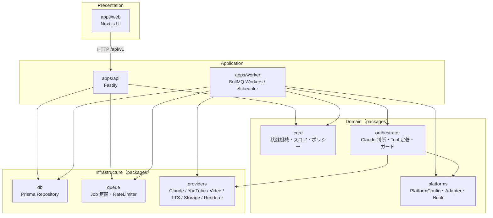
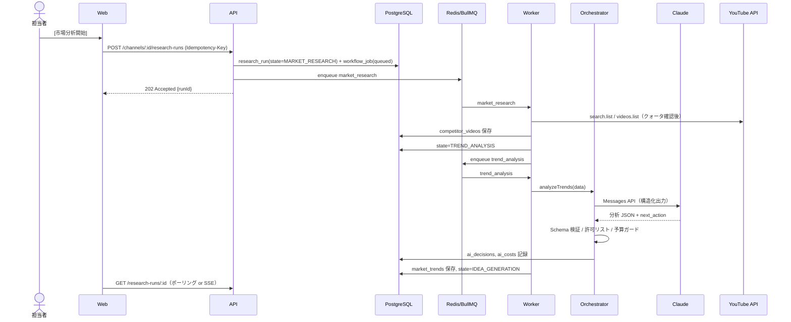

# アーキテクチャ

## 全体像



### レイヤー規則

| レイヤー | 依存してよい先 | 禁止 |
|------|------|------|
| `apps/web` | `packages/schemas`（型のみ） | Secret・Provider・DB への直接アクセス |
| `apps/api` | core / db / queue / schemas / config | 長時間処理（必ずジョブ化） |
| `apps/worker` | すべての packages | — |
| `packages/core` | schemas | 外部 I/O（純粋関数に保つ → テスト容易） |
| `packages/orchestrator` | core / schemas / providers のインターフェース | Provider 実装への直接依存 |
| `packages/providers` | schemas / config | ビジネスロジック |
| `packages/platforms` | schemas | 外部 I/O、SNS 名によるハードコード分岐（差異は Config か Adapter で表す） |

依存方向は ESLint（`eslint-plugin-boundaries` 等）で CI 強制する。

## リクエストとジョブの流れ（例: 市場分析開始）



## 再開性（Resumability）

- 状態遷移は **DB トランザクション内で「状態更新 + 次ジョブの outbox 行挿入」** を行い、別プロセスが outbox から BullMQ へ投入する（Transactional Outbox）。プロセスが途中で落ちてもジョブが失われない。
- 各ジョブは `idempotency_key`（例: `script:{projectId}:v{version}`）を持ち、二重実行しても結果が重複しない。
- 外部の長時間処理（動画生成）は `video_generations.external_job_id` を保存し、再起動後はポーリングを再開するだけで済む。
- 起動時に「`running` のまま `heartbeat_at` が古いジョブ」を検出して再投入する reaper を Worker に置く。

## 拡張性の設計

| 将来要件 | 設計上の備え |
|------|------|
| 複数チャンネル | 全業務テーブルに `channel_id`。設定は `channel_settings` に分離 |
| 複数ユーザー / 組織 | `users` ↔ `channel_members`（ロール）。将来 `organizations` を上位に追加可能な ID 設計 |
| 複数動画生成 AI / TTS | Provider Registry + 設定でチャンネル別に優先順位・フォールバック順を指定 |
| 複数フォーマット（Shorts / 通常動画） | `video_projects.format`（`SHORTS_9_16` / `LANDSCAPE_16_9`）と `RenderProfile` |
| 複数 SNS（TikTok / Reels / X / Facebook / Threads …） | `packages/platforms` の PlatformConfig + Adapter。投稿は `Publisher` Adapter、投稿記録は汎用の `publications`（[multi-platform.md](./multi-platform.md)） |
| ワークフローの高度化 | 状態機械を `packages/core` に閉じ込め、将来 Temporal に置き換え可能な境界にする |

## 技術選定と理由

### 言語: TypeScript（全層）
- 台本 JSON・Claude の判断スキーマ・API DTO を **Zod スキーマ 1 か所で定義し、Front/API/Worker で共有** できる。Claude の構造化出力用 JSON Schema も Zod から生成。
- Anthropic 公式 SDK（`@anthropic-ai/sdk`）、Google API 公式クライアント（`googleapis`）が揃う。
- 不採用: Python（動画処理・ML ライブラリは強いが、Front と型共有できず 2 言語運用になる。FFmpeg は CLI で使うため言語の優劣は小さい）。

### Frontend: Next.js（UI 専用）
- App Router + Tailwind + shadcn/ui でレスポンシブな承認画面を短期間で作れる。
- **Secret を持たない**。`/api/*` は Next の rewrite で API サーバへ転送し、同一オリジン Cookie で認証（CORS 不要・CSRF 対策が単純）。
- 不採用: Next.js の Route Handler を Backend にする案 → Worker と同じドメインロジックを共有しにくく、長時間処理と信頼境界が曖昧になる。

### Backend: Fastify
- 高速・軽量、プラグインで認証/Rate Limit/Helmet/CSRF を追加可能。`fastify-type-provider-zod` でスキーマ駆動。
- 不採用: NestJS（DI と抽象化が MVP には過剰）、Express（型・スキーマ統合が弱い）。

### Workflow: 自前状態機械 + BullMQ
- 必要な機能（リトライ・指数バックオフ・遅延ジョブ・レートリミット・優先度）は BullMQ で揃う。
- 「どの状態から再開するか」は DB の状態が正。BullMQ は実行手段にすぎない。
- 不採用（現時点）: Temporal（耐久性は最高だが、サーバ運用 or Temporal Cloud の費用と学習コスト）。Phase 6 で並行ワークフローが増えたら再検討。

### DB: PostgreSQL + Prisma
- KPI 集計・時系列（投稿後統計）は SQL が得意。AI 出力は JSONB に `schema_version` 付きで保存。
- Prisma: 型安全なクエリとマイグレーション。集計は `$queryRaw`（タグ付きテンプレート = パラメータ化）。
- 不採用: MongoDB（集計・整合性で不利）、Drizzle（有力な代替。チームの慣れで Prisma を選択。差し替えは repository 層に閉じる）。

### Storage: S3 互換（Cloudflare R2）
- 動画ファイルは大きく、プレビュー配信でエグレスが発生する → **エグレス無料の R2** が有利。署名付き URL（有効期限短）で配信。
- 開発環境は MinIO。`StorageProvider` で抽象化するため AWS S3 / GCS への変更も容易。

### 動画編集: FFmpeg
- 結合・字幕（ASS）焼き込み・音声ミックス（ラウドネス正規化 `loudnorm` で -14 LUFS 目安）・スケール/パディングで 9:16・fps 統一・サムネイル抽出まで 1 ツールで完結。
- Worker の Docker イメージに静的ビルドを同梱。重い処理なので `render` 専用キューと並列数制限。
- 将来: Remotion（React でテロップ演出）を `Renderer` の別実装として追加可能。

### ホスティング
- FFmpeg・数分〜数十分のジョブがあるため **Serverless（Vercel Functions / Lambda）単体は不適**。
- MVP: コンテナ PaaS（Render / Railway / Fly.io 等）に web / api / worker の 3 サービス + マネージド Postgres / Redis。
- スケール時: AWS（ECS Fargate + RDS + ElastiCache + S3/R2）。Docker イメージ単位なので移行容易。

## フォルダ構成

```
ai-youtube-agent/
├── apps/
│   ├── web/
│   │   ├── app/                 # App Router（(auth)/, dashboard/, research/, ideas/, projects/, approvals/）
│   │   ├── components/
│   │   └── lib/api-client.ts    # 型付き API クライアント（schemas から生成）
│   ├── api/
│   │   ├── src/routes/          # auth, channels, research, ideas, projects, approvals, costs, jobs, audit
│   │   ├── src/plugins/         # session, csrf, rate-limit, error-handler, security-headers
│   │   └── src/server.ts
│   └── worker/
│       ├── src/jobs/            # market-research.ts, trend-analysis.ts, generate-idea.ts, ...
│       ├── src/scheduler.ts     # 定期分析・投稿後計測の登録
│       ├── src/outbox-relay.ts
│       └── src/reaper.ts
├── packages/
│   ├── core/src/
│   │   ├── workflow/            # states.ts, transitions.ts, guards.ts
│   │   ├── scoring/             # trend-score.ts, originality-score.ts, performance-score.ts
│   │   ├── policy/              # auto-publish-policy.ts, budget-policy.ts
│   │   └── cost/
│   ├── orchestrator/src/
│   │   ├── prompts/             # system/*.md, task テンプレート
│   │   ├── tools/               # 15 Tool の定義（名前・説明・入力スキーマ・権限クラス）
│   │   ├── decision.ts          # 判断スキーマと検証
│   │   └── tasks/               # analyzeTrends, generateIdeas, generateScript, reviseScript, qualityCheck, ...
│   ├── providers/src/
│   │   ├── claude/              # ClaudeProvider（Anthropic SDK）
│   │   ├── youtube/             # YouTubeProvider（Data API / Analytics / Upload）+ quota
│   │   ├── video/               # VideoProvider interface + veo/ kling/ runway/ mock/
│   │   ├── tts/                 # TTSProvider interface + elevenlabs/ google/ mock/
│   │   ├── storage/             # StorageProvider（S3 互換）
│   │   ├── renderer/            # FFmpeg Renderer
│   │   └── registry.ts          # Provider 選択・フォールバック
│   ├── db/
│   │   ├── prisma/schema.prisma
│   │   ├── prisma/migrations/
│   │   └── src/repositories/
│   ├── platforms/src/           # types, registry, adapters/, targets/, hooks/, render-spec, text, cache-key
│   ├── queue/src/               # job-names.ts, retry-policy.ts, rate-limiter.ts, outbox.ts
│   ├── schemas/src/             # script.ts, idea.ts, decision.ts, api/*.ts
│   └── config/src/env.ts
├── infra/docker/
│   ├── docker-compose.yml       # postgres, redis, minio
│   ├── api.Dockerfile
│   ├── worker.Dockerfile        # ffmpeg 同梱
│   └── web.Dockerfile
├── docs/
└── .github/
```

`mock` Provider を全種類に用意し、**API キーなしでローカル E2E が動く** ようにする（CI もこれを使う）。
