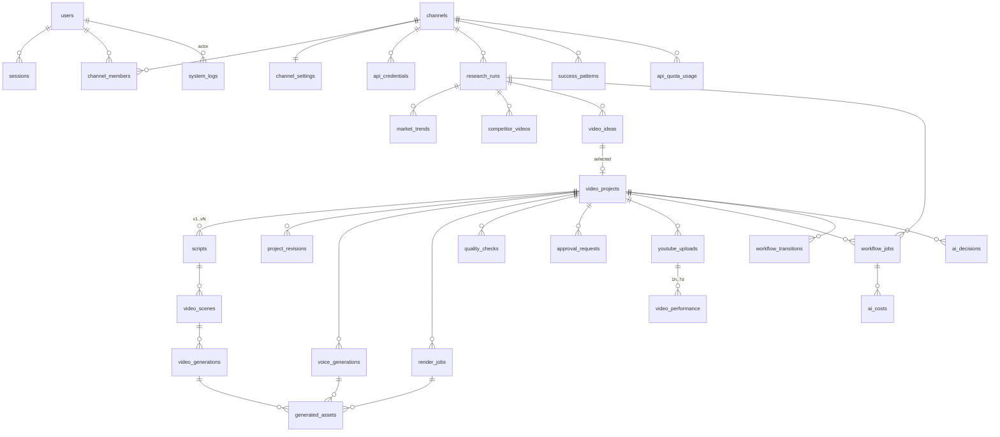

# データベース設計

PostgreSQL 16 / Prisma。

## 共通ルール

- 主キー: `id UUID`（UUIDv7 = 時系列ソート可能）
- 全テーブル: `created_at`, `updated_at`（timestamptz）
- 業務テーブルは原則 `channel_id` を持つ（マルチチャンネル・将来のテナント分離）
- AI 出力は `JSONB` + `schema_version`（スキーマ変更時に旧データを読める）
- 金額: `cost_usd NUMERIC(12,6)`
- 削除: 業務データは論理削除（`deleted_at`）。監査系は削除不可（追記のみ）
- 列挙型は PostgreSQL enum（Prisma enum）

## ER 図



## テーブル定義（主要カラム）

### 認証・組織

| テーブル | 主要カラム |
|------|------|
| `users` | email (unique), password_hash (argon2id), display_name, status, last_login_at, mfa_secret_enc (Phase 6) |
| `sessions` ★ | user_id, token_hash, csrf_token_hash, ip, user_agent, expires_at, revoked_at |
| `channel_members` ★ | channel_id, user_id, role (`OWNER` / `EDITOR` / `APPROVER` / `VIEWER`) |

### チャンネル

| テーブル | 主要カラム |
|------|------|
| `channels` | name, youtube_channel_id, platform (`YOUTUBE`), default_format, status |
| `channel_settings` | genre, sub_genres[], target_audience, tone, language (`ja`), region (`JP`), default_duration_sec, ng_words[], brand_guidelines (text), preferred_video_provider, preferred_tts_provider, voice_id, idea_selection_mode (`MANUAL`/`AUTO_TOP`), auto_publish_enabled (default false), auto_publish_thresholds (jsonb), daily_budget_usd, monthly_budget_usd, per_video_budget_usd |
| `api_credentials` | channel_id, provider (`YOUTUBE_OAUTH` 等), encrypted_payload (bytea, AES-256-GCM), key_version, scopes[], expires_at, revoked_at ※平文は保存しない |

### 市場分析

| テーブル | 主要カラム |
|------|------|
| `research_runs` ★ | channel_id, state, keywords[], region, params (jsonb), quota_used, started_at, completed_at |
| `competitor_videos` | research_run_id, youtube_video_id, title, description_excerpt, channel_youtube_id, channel_title, channel_subscribers, published_at, duration_sec, is_short_estimated, category_id, tags[], view_count, like_count, comment_count, fetched_at, age_hours, views_per_hour, views_per_subscriber, like_rate, comment_rate ※(research_run_id, youtube_video_id) unique |
| `market_trends` | research_run_id, topic, trend_type (`RISING`/`SURGING`/`EVERGREEN`/`SHORT_LIVED`), trend_score, score_breakdown (jsonb), competition_level, audience_needs (jsonb), title_patterns (jsonb), hook_patterns (jsonb), structure_patterns (jsonb), differentiation (jsonb), uncertainty, risks (jsonb), evidence_video_ids[] |

### 企画・台本

| テーブル | 主要カラム |
|------|------|
| `video_ideas` | research_run_id, channel_id, label (`A`/`B`/`C`), title, theme, target, hook, story, duration_sec, scene_count, cta, trend_score, originality_score, score_rationale (jsonb), similar_videos (jsonb), copy_risk, risks (jsonb), status (`PROPOSED`/`SELECTED`/`DISCARDED`) |
| `video_projects` | channel_id, idea_id, code (`VP-0001`), format, state, current_script_version, current_render_id, total_cost_usd, paused_reason, failed_reason |
| `scripts` | project_id, version, parent_version, content (jsonb：§17 の台本 JSON), schema_version, created_by (`AI`/`USER`), revision_id ※(project_id, version) unique |
| `video_scenes` | script_id, scene_number, duration_sec, visual_prompt, narration, subtitle, sound_effect, transition |
| `project_revisions` ★ | project_id, from_version, to_version, instruction（例: 「冒頭を強く」）, requested_by, diff_summary (jsonb) |

### 制作

| テーブル | 主要カラム |
|------|------|
| `video_generations` | project_id, scene_id, script_version, provider, model, prompt, negative_prompt, params (jsonb), external_job_id, status, attempt, duration_sec, cost_usd, error_code, error_message |
| `voice_generations` | project_id, script_version, provider, voice_id, text, chars, status, duration_sec, cost_usd |
| `render_jobs` | project_id, script_version, render_profile (jsonb: 1080x1920, 30fps, -14 LUFS), ffmpeg_command_hash, status, output_asset_id, duration_sec, log_excerpt |
| `generated_assets` | project_id, kind (`VIDEO_CLIP`/`VOICE`/`BGM`/`SFX`/`SUBTITLE`/`FINAL_VIDEO`/`THUMBNAIL`/`FRAME`), storage_key, mime, bytes, sha256, duration_sec, license_type (`GENERATED`/`LICENSED`/`OWN`), license_ref, source_generation_id |

### 品質・承認・投稿

| テーブル | 主要カラム |
|------|------|
| `quality_checks` | project_id, script_version, render_id, total_score, item_scores (jsonb: §21 の各項目), copyright_risk, policy_risk, ai_content_risk, mass_production_risk (`LOW`/`MEDIUM`/`HIGH`), findings (jsonb), measured (jsonb: 実測尺・LUFS 等), model |
| `approval_requests` | project_id, script_version, render_id, quality_check_id, status (`PENDING`/`APPROVED`/`CHANGES_REQUESTED`/`REJECTED`/`REGENERATE`), decided_by, decided_at, comment, snapshot (jsonb: 承認時点のメタデータ一式) |
| `youtube_uploads` | project_id, approval_request_id, youtube_video_id, title, description, tags[], privacy_status, publish_at, contains_synthetic_media, made_for_kids, status, quota_cost, uploaded_at, error_message |
| `video_performance` | upload_id, checkpoint (`H1`/`H3`/`H6`/`H12`/`H24`/`H48`/`D7`/…), hours_since_publish, views, likes, comments, avg_view_duration_sec, avg_view_percentage, subscribers_gained, estimated_revenue (Analytics, nullable), fetched_at ※(upload_id, checkpoint) unique |

### 学習

| テーブル | 主要カラム |
|------|------|
| `success_patterns` ★ | channel_id, pattern_type (`HOOK`/`TOPIC`/`STRUCTURE`/`TITLE`/`DURATION`/…), description, evidence_upload_ids[], effect_size, confidence, status (`ACTIVE`/`RETIRED`), first_seen_at, last_validated_at |

### 運用・監査・コスト

| テーブル | 主要カラム |
|------|------|
| `workflow_jobs` | job_type, channel_id, project_id, research_run_id, idempotency_key (unique), status (`QUEUED`/`RUNNING`/`SUCCEEDED`/`FAILED`/`CANCELLED`/`WAITING_EXTERNAL`), priority, attempt / retry_count, max_attempts, started_at, completed_at, heartbeat_at, next_run_at, error_code, error_message, cost_usd, input (jsonb), output_ref |
| `workflow_transitions` ★ | entity_type (`RESEARCH_RUN`/`PROJECT`), entity_id, from_state, to_state, trigger (`JOB`/`USER`/`AI_DECISION`/`SYSTEM`), actor_id, job_id, decision_id |
| `outbox_events` ★ | event_type, payload (jsonb), published_at ※状態更新と同一トランザクションで挿入 |
| `ai_decisions` ★ | channel_id, project_id, research_run_id, state, next_action, reason, confidence, parameters (jsonb), data_refs[], accepted (bool), rejected_reason（ガードで拒否された場合）, model, prompt_version, request_id |
| `ai_costs` | job_id, channel_id, project_id, provider, model, operation, input_tokens, output_tokens, cache_read_tokens, cache_write_tokens, units（秒・文字数など）, unit_type, cost_usd, estimated (bool), latency_ms, request_id |
| `api_quota_usage` ★ | provider, quota_bucket（例: `youtube:projectX`）, date (PT 基準), units_used, units_limit |
| `provider_pricing` ★ | provider, model, unit_type, unit_price_usd, effective_from ※単価をコードに埋め込まない |
| `system_logs` | level, category (`AUTH`/`SETTINGS`/`APPROVAL`/`SECRET_ACCESS`/`PROVIDER`/…), actor_id, channel_id, message, context (jsonb, Secret はマスク), ip |

## インデックス（主なもの）

- `video_projects (channel_id, state)` — ダッシュボード「制作中 / 承認待ち」
- `approval_requests (status, created_at)`
- `workflow_jobs (status, next_run_at)`, `workflow_jobs (heartbeat_at) WHERE status='RUNNING'`
- `ai_costs (created_at)`, `ai_costs (channel_id, created_at)` — 日次・月次集計
- `competitor_videos (youtube_video_id)`
- `video_performance (upload_id, checkpoint)`

## バージョン管理の考え方（指示書 §33）

```
Video Project VP-0001
├── idea (video_ideas)            … 市場分析の根拠（research_run, market_trends）に紐付く
├── scripts v1 ── video_generations / voice / render (script_version=1) ── quality_check ── approval(CHANGES_REQUESTED)
│     └─ project_revisions「冒頭を強く」
├── scripts v2 ── …(script_version=2) ── quality_check ── approval(APPROVED)
└── youtube_uploads ── video_performance(H1…D7)
```

- 台本は **イミュータブル**（修正は新バージョンを作る）。
- 生成物はすべて `script_version` を持ち、どの台本から作られたか追跡可能。
- シーン単位の再生成時は、変更のないシーンのクリップを再利用（コスト削減）。
