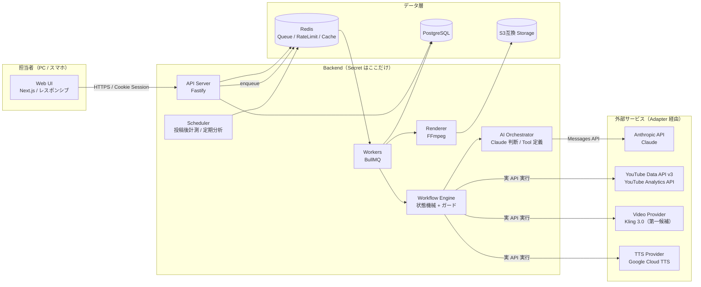
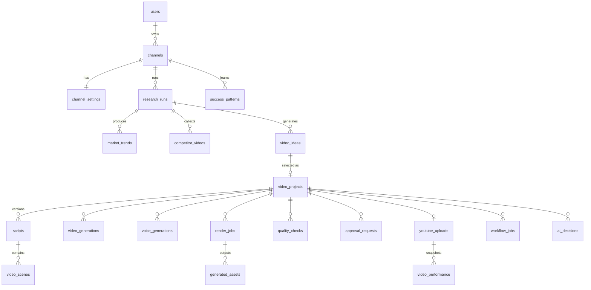

# 設計提案書（Phase 0）

> ステータス: **承認済み（2026-10-29）** — Phase 1 実装中。決定事項は [decisions.md](./decisions.md)
> 作成日: 2026-10-29
> 対象: AI YouTube Agent（YouTube Shorts 中心の企画〜投稿〜分析自動化プラットフォーム）

本書は開発指示書 §44 / §47 で要求された「実装前に提示すべき項目」を 1 か所にまとめたものです。
詳細は各ドキュメントに分割しています。

| # | 項目 | 本書の章 | 詳細ドキュメント |
|---|------|---------|----------------|
| 1 | システムアーキテクチャ図 | §1 | [architecture.md](./architecture.md) |
| 2 | 技術スタック | §2 | [architecture.md](./architecture.md#技術選定と理由) |
| 3 | フォルダ構成 | §3 | [architecture.md](./architecture.md#フォルダ構成) |
| 4 | DB ER図 | §4 | [database.md](./database.md) |
| 5 | API一覧 | §5 | [api.md](./api.md) |
| 6 | Claude Tool一覧 | §6 | [ai-orchestrator.md](./ai-orchestrator.md) |
| 7 | Workflow State一覧 | §7 | [workflow.md](./workflow.md) |
| 8 | 外部サービス一覧 | §8 | [providers.md](./providers.md) |
| 9 | 必要なAPIキー一覧 | §9 | [security.md](./security.md) |
| 10 | 月額ランニングコスト概算 | §10 | [cost-management.md](./cost-management.md) |
| 11 | MVP範囲 | §11 | — |
| 12 | Phase 2以降のロードマップ | §12 | — |
| 13 | 技術的に実現できない機能 | §13 | — |
| 14 | YouTube API制限 | §14 | [providers.md](./providers.md#youtube) |
| 15 | 動画生成APIの制限 | §15 | [providers.md](./providers.md#video) |
| 16 | セキュリティ上の注意点 | §16 | [security.md](./security.md) |
| 17 | GitHub開発フロー | §17 | [deployment.md](./deployment.md#github-開発フロー) |

---

## 1. システムアーキテクチャ



**最重要の設計原則**

1. **Claude は「判断」だけを返し、実行は Workflow Engine が行う。** Claude の出力（次アクション・パラメータ）は JSON Schema で検証され、状態ごとの許可リスト・予算・人間承認ゲートを通過した場合のみ実行される。Claude に Secret は一切渡さない。
2. **すべての状態は PostgreSQL に永続化。** ジョブは冪等に設計し、再起動・API 障害後も途中から再開できる。
3. **外部サービスは Provider/Adapter の背後に隠す。** ビジネスロジックは `VideoProvider` などのインターフェースだけを知る。
4. **初期版は必ず人間承認を経由して投稿。** 自動投稿は条件付きで将来有効化する設計だけ用意する（デフォルト OFF）。

## 2. 技術スタック（結論）

| 領域 | 採用 | 主な理由 / 不採用案 |
|------|------|------|
| 言語 | **TypeScript（全層）** | Front/Back/Worker で型（台本 JSON 等）を共有できる。Anthropic・Google 公式 SDK あり |
| Monorepo | **pnpm workspaces + Turborepo** | apps と共有 packages を分離しつつ CI をキャッシュで高速化 |
| Frontend | **Next.js (App Router) + Tailwind CSS + shadcn/ui** | レスポンシブ承認画面を素早く構築。**UI 専用**（Secret を持たない） |
| Backend API | **Fastify + Zod** | 軽量・高速・スキーマ駆動。NestJS は MVP には重い |
| Worker | **BullMQ（Node.js）** | Retry / Backoff / Rate Limit / 遅延ジョブ（投稿後計測）を標準装備 |
| Workflow | **自前の状態機械（DB 永続） + BullMQ** | Temporal は理想的だが運用負荷が高い。規模拡大時の移行パスを残す |
| DB | **PostgreSQL 16** | JSONB で AI 出力を柔軟に保存しつつ、集計（KPI）は SQL で |
| ORM | **Prisma** | 型安全・マイグレーション管理。複雑な集計は `$queryRaw`（パラメータ化）で |
| Queue / Cache | **Redis 7** | BullMQ、レートリミッタ、API レスポンスキャッシュ |
| 動画編集 | **FFmpeg（Worker コンテナに同梱）** | 結合・字幕焼き込み・ミックス・9:16・サムネイル |
| AI | **Anthropic Claude API（公式 TS SDK）** | 既定モデル `claude-opus-5-5`。タスク単位で設定変更可能 |
| Storage | **S3 互換（本番: Cloudflare R2 推奨 / 開発: MinIO）** | 動画の配信・ダウンロードでエグレス料金がかからない |
| 認証 | **自前セッション認証（argon2id + DB セッション + httpOnly Cookie）** | 外部 IdP 不要で MVP に十分。将来 OAuth/SSO を追加可能 |
| テスト | **Vitest + Playwright（E2E は Phase 1 後半）** | |
| インフラ | **Docker / docker compose（開発） → Render（本番 MVP、ADR-004）** | FFmpeg と長時間ジョブがあるため Serverless 不適 |
| CI | **GitHub Actions** | Lint / Typecheck / Test / Build / Security（CodeQL, gitleaks, audit） |

詳細な比較は [architecture.md](./architecture.md#技術選定と理由)。

## 3. フォルダ構成

```
ai-youtube-agent/
├── apps/
│   ├── web/              # Next.js（UI のみ。/api/* は API サーバへ rewrite）
│   ├── api/              # Fastify REST API（認証・CRUD・ジョブ投入）
│   └── worker/           # BullMQ Worker / Scheduler / FFmpeg レンダリング
├── packages/
│   ├── core/             # ドメインモデル・状態機械・スコア計算（純粋関数）
│   ├── orchestrator/     # Claude プロンプト・Tool 定義・判断スキーマ・ガード
│   ├── providers/        # claude/ youtube/ video/ tts/ storage/ の Adapter
│   ├── db/               # Prisma schema・migrations・repository
│   ├── queue/            # ジョブ定義・レートリミッタ・リトライポリシー
│   ├── schemas/          # Zod スキーマ（台本 JSON・API DTO）共有
│   ├── config/           # 環境変数の読み込みと検証
│   └── tsconfig/ eslint-config/
├── infra/
│   └── docker/           # Dockerfile 群・docker-compose.yml
├── docs/                 # 設計ドキュメント（本書含む）
├── .github/
│   ├── workflows/        # ci.yml / security.yml / deploy.yml（将来）
│   ├── ISSUE_TEMPLATE/
│   └── pull_request_template.md
├── .env.example
├── CLAUDE.md             # Claude が本リポジトリで開発する際のルール
└── README.md
```

## 4. DB ER図（概要）

指示書 §32 の 21 テーブル ＋ 運用上必要な追加テーブル（`sessions`, `channel_members`, `research_runs`, `workflow_transitions`, `outbox_events`, `ai_decisions`, `project_revisions`, `success_patterns`, `api_quota_usage`, `provider_pricing`）。
ER 図・カラム定義は [database.md](./database.md)。



## 5. API 一覧（抜粋）

REST / JSON、`/api/v1` プレフィックス。全一覧は [api.md](./api.md)。

| 分類 | 主なエンドポイント |
|------|------|
| 認証 | `POST /auth/login` `POST /auth/logout` `GET /auth/me` |
| チャンネル | `GET/POST /channels` `GET/PATCH /channels/:id/settings` |
| YouTube 連携 | `GET /channels/:id/youtube/connect` `GET /oauth/youtube/callback` |
| 市場分析 | `POST /channels/:id/research-runs` `GET /research-runs/:id` `GET /research-runs/:id/trends` |
| 企画 | `GET /research-runs/:id/ideas` `POST /ideas/:id/select` |
| プロジェクト | `GET /projects` `GET /projects/:id` `GET /projects/:id/versions` |
| 台本 | `GET /projects/:id/scripts/:version` `POST /projects/:id/revisions` |
| 承認 | `GET /approvals?status=pending` `POST /approvals/:id/approve` `…/request-changes` `…/reject` `…/regenerate` |
| 投稿 | `GET /uploads` `PATCH /uploads/:id/schedule` |
| 分析 | `GET /projects/:id/performance` `GET /dashboard/today` `GET /dashboard/kpi` |
| コスト | `GET /costs/summary` `GET /costs/breakdown` |
| ジョブ | `GET /jobs` `POST /jobs/:id/retry` `POST /jobs/:id/cancel` |
| 監査 | `GET /audit/decisions` `GET /audit/logs` |

## 6. Claude Tool 一覧

指示書 §10 の 15 Tool を **権限クラス** で分類し、実行前に Workflow Engine がガードする。詳細は [ai-orchestrator.md](./ai-orchestrator.md)。

| Tool | クラス | 実行主体 | コスト/クォータ |
|------|------|------|------|
| `search_youtube_trends` | READ | YouTubeProvider | YouTube quota 大（search=100u） |
| `get_video_statistics` | READ | YouTubeProvider | 1u / 50本 |
| `analyze_competitor` | READ+LLM | YouTubeProvider + Claude | quota 小 + tokens |
| `calculate_trend_score` | COMPUTE | core（決定論的コード） | 0 |
| `calculate_originality_score` | COMPUTE | core + Claude 判定 | tokens |
| `calculate_cost` | COMPUTE | core | 0 |
| `generate_video_idea` | LLM | Claude | tokens |
| `generate_script` | LLM | Claude（構造化出力） | tokens |
| `create_youtube_metadata` | LLM | Claude | tokens |
| `check_video_quality` | LLM | Claude（フレーム画像 + 字幕 + 音量計測値） | tokens |
| `generate_video` | COSTLY | VideoProvider | **高額**（予算ガード必須） |
| `generate_voice` | COSTLY | TTSProvider | 中 |
| `render_video` | COMPUTE | Renderer(FFmpeg) | CPU |
| `upload_youtube` | **SIDE_EFFECT / HUMAN_GATED** | YouTubeProvider | 1,600u、**承認必須** |
| `get_video_performance` | READ | YouTube Data/Analytics | 1u |

Claude の判断出力（構造化出力で強制）:

```json
{
  "next_action": "GENERATE_SCRIPT",
  "reason": "市場分析の結果、この企画の成長性が高い",
  "confidence": 0.87,
  "parameters": { "idea_id": "..." },
  "risks": ["競合密度が中程度"],
  "data_refs": ["research_run:...", "competitor_video:..."]
}
```

## 7. Workflow State 一覧

指示書 §9 の状態に、運用上必須の **ゲート/例外状態** を追加。詳細と遷移表は [workflow.md](./workflow.md)。

| 状態 | 種別 | スコープ |
|------|------|------|
| `IDLE` | 待機 | Channel |
| `MARKET_RESEARCH` | Job | ResearchRun |
| `TREND_ANALYSIS` | Job | ResearchRun |
| `IDEA_GENERATION` | Job | ResearchRun |
| `WAITING_IDEA_SELECTION` ★追加 | 人間ゲート（設定で自動選択可） | ResearchRun |
| `SCRIPT_GENERATION` | Job | Project |
| `VIDEO_GENERATION` | Job（長時間・ポーリング） | Project |
| `VOICE_GENERATION` | Job | Project |
| `VIDEO_EDITING` | Job（FFmpeg） | Project |
| `QUALITY_CHECK` | Job | Project |
| `WAITING_APPROVAL` | 人間ゲート | Project |
| `REVISING` ★追加 | Job（修正指示の反映 → SCRIPT 以降へ戻る） | Project |
| `YOUTUBE_UPLOAD` | Job | Project |
| `SCHEDULED` ★追加 | 予約公開待ち | Project |
| `PERFORMANCE_ANALYSIS` | 遅延 Job（1h/3h/6h/12h/24h/48h/7d） | Project |
| `LEARNING` | Job | Channel |
| `NEXT_CYCLE` | 遷移 | Channel |
| `FAILED` / `PAUSED` / `CANCELLED` / `REJECTED` ★追加 | 例外 | 共通 |

## 8. 外部サービス一覧

| サービス | 用途 | Phase |
|------|------|------|
| Anthropic Claude API | 分析・企画・台本・QC・判断 | 1 |
| YouTube Data API v3 | 市場データ収集・投稿・統計 | 1（読取）/ 3（投稿） |
| Google OAuth 2.0 | YouTube チャンネル連携 | 1（読取用は API Key で可）/ 3 |
| YouTube Analytics API | 自チャンネルの視聴維持率・視聴時間・推定収益 | 4 |
| 動画生成（**Kling 3.0 Standard**、ADR-002） | シーン動画生成 | 2 |
| TTS（**Google Cloud TTS**、ADR-003） | ナレーション | 2 |
| S3 互換ストレージ（Cloudflare R2） | 素材・完成動画・サムネイル | 2（Phase 1 はメタデータのみ） |
| PostgreSQL / Redis（マネージド） | DB / Queue | 1 |
| メール送信（Resend 等）/ Web Push | 承認依頼通知 | 1（メール）/ 6（Push） |
| ライセンス済み BGM・効果音ライブラリ | BGM / SE（権利確認済みのみ） | 2 |

## 9. 必要な API キー一覧

すべて **Backend（api / worker）の環境変数のみ**。フロントエンドには一切渡さない。詳細は [security.md](./security.md#secret-一覧)。

| 変数 | 取得先 | Phase |
|------|------|------|
| `ANTHROPIC_API_KEY` | console.anthropic.com | 1 |
| `YOUTUBE_API_KEY` | Google Cloud Console（YouTube Data API v3 有効化） | 1 |
| `GOOGLE_OAUTH_CLIENT_ID` / `GOOGLE_OAUTH_CLIENT_SECRET` | Google Cloud Console（OAuth 同意画面の審査が必要） | 3 |
| `TOKEN_ENCRYPTION_KEY` | 自前生成（32byte, OAuth トークン暗号化用） | 1 |
| `SESSION_SECRET` | 自前生成 | 1 |
| `DATABASE_URL` / `REDIS_URL` | DB / Redis 事業者 | 1 |
| `S3_ENDPOINT` / `S3_ACCESS_KEY_ID` / `S3_SECRET_ACCESS_KEY` / `S3_BUCKET` | Cloudflare R2 等 | 2 |
| `KLING_ACCESS_KEY` / `KLING_SECRET_KEY` | Kling 開発者コンソール | 2 |
| `GOOGLE_TTS_CREDENTIALS` | Google Cloud（Text-to-Speech API を有効化したサービスアカウント） | 2 |
| `MAIL_API_KEY` | Resend 等 | 1 |

## 10. 月額ランニングコスト概算

前提: Shorts（30 秒・6 シーン）を **月 60 本**（1 日 2 本）制作。価格は 2026-10 時点の公開情報ベースの概算で、**動画生成 API は価格改定が頻繁なため導入時に再確認する。**

| 項目 | 月額概算 | 備考 |
|------|------|------|
| Claude API | **$40〜$90** | 1 本あたり約 $0.6〜$1.2（Opus 5.5: 入力 $4 / 出力 $20 per 1M tokens）＋ 市場分析・学習。プロンプトキャッシュ・Batch API（50% off）で削減 |
| 動画生成 API（Kling 3.0 Standard・音声なし） | **$200〜$270** | 30 秒 × 60 本 × 再生成率 1.3 ≒ 2,340 秒。$0.084/秒（720p）〜$0.112/秒（1080p）。**最大のコスト要因**（単価は契約時に要確認） |
| TTS（Google Cloud TTS） | **$0〜$5** | 約 300 文字/本 × 60 = 約 2 万文字。Chirp 3: HD の無料枠（100 万文字/月）内 |
| YouTube API | **$0** | 無料（クォータ制） |
| インフラ（Render: web/api/worker + Postgres + Key Value） | **$40〜$100** | |
| ストレージ（R2） | **$1〜$5** | 1 本 50〜100MB、エグレス無料 |
| メール等 | **$0〜$20** | |
| **合計** | **約 $280〜$490 / 月** | Phase 1（動画生成なし）のみなら **約 $60〜$150 / 月** |

初期費用: 開発者の工数を除き **ほぼ $0**（ドメイン・各 API のデポジット程度）。
詳細とコスト上限（予算ガード）設計は [cost-management.md](./cost-management.md)。

## 11. MVP 範囲（Phase 1）

**含める**

- ログイン（単一組織・複数ユーザー、ロール: owner / editor / approver）
- チャンネル設定（ジャンル・ターゲット・トーン・NG ワード・尺・言語・地域）
- 市場分析ジョブ（YouTube Data API: キーワード検索 + 人気動画 + 統計取得、クォータ管理・キャッシュ）
- Claude によるトレンド分析・競合パターン抽出
- Trend Score（決定論的計算 + Claude の定性評価、根拠・不確実性つき）
- 企画生成（A/B/C 案、Originality Score、リスク）と担当者の選択
- 台本生成（§17 の JSON 形式、Zod 検証）と修正指示（バージョン保存）
- 承認画面（動画なしの「台本承認」モード。スマホ対応）
- ダッシュボード（今日のトレンド・企画・承認待ち・AI コスト）
- AI コスト記録・監査ログ（Claude の判断履歴）
- Job Queue / Retry / 状態の DB 永続化と再開
- GitHub Actions（Lint / Typecheck / Test / Build / Security）

**含めない（Phase 2 以降）**: 動画生成、TTS、FFmpeg、YouTube 投稿、投稿後分析、自動投稿、Push 通知。

## 12. Phase 2 以降のロードマップ

| Phase | 内容 | 完了条件 |
|------|------|------|
| 2 動画制作 | VideoProvider（まず 1 社）・TTSProvider（1 社）・FFmpeg レンダリング・字幕・BGM・9:16 MP4・サムネイル・AI 品質チェック（フレーム抽出） | 台本から 30 秒 MP4 を自動生成し承認画面でプレビューできる |
| 3 YouTube 投稿 | OAuth 連携（トークン暗号化）・投稿・予約公開・投稿履歴・Google OAuth 審査対応 | 承認ボタンで限定公開/予約投稿できる |
| 4 分析 | 1h〜7d 定期取得・YouTube Analytics API・KPI ダッシュボード・Performance Score・Trend Score の重み補正 | 投稿後 7 日分の推移とKPIが見える |
| 5 AI フィードバック | 過去動画分析・成功パターン抽出（`success_patterns`）・企画プロンプトへの反映・A/B 検証 | 新企画に「参照した成功パターン」が根拠として表示される |
| 6 自動化 | Scheduler による定期市場分析・自動制作・Provider フォールバック強化・条件付き自動投稿（§41）・Push 通知 | 担当者操作が「承認」のみになる |
| 7 拡張 | 複数チャンネル運用の UI 強化・通常動画（16:9）・TikTok / Reels 用 PublishTarget | |

## 13. 技術的に実現できない / 制約のある機能

| 要望 | 実現性 | 理由と代替案 |
|------|------|------|
| 「必ずバズる」予測 | **不可（方針として禁止）** | 予測スコア・根拠・不確実性・リスクとして表示する |
| Shorts フィード（おすすめ）の取得 | **不可** | API が存在しない。`videoDuration=short`（4 分未満）検索 + 尺・縦型判定で Shorts を推定する |
| 競合動画のインプレッション・CTR・視聴維持率 | **不可** | 他者チャンネルの Analytics は取得不可。公開統計（再生・高評価・コメント）のみ |
| 低評価数 | **不可** | 2021 年以降 API で非公開 |
| 自チャンネルの視聴維持率・CTR・収益 | **条件付き可** | YouTube Analytics API + OAuth。収益は YPP 加入と追加スコープが必要。数値は 24〜72h 遅延あり |
| 秒単位のリアルタイム再生数 | **不可** | 統計はキャッシュされ遅延・丸めがある |
| YouTube 画面のスクレイピング | **禁止** | 規約違反。API のみ使用 |
| 1 日に大量投稿 | **不可（クォータ）** | 既定 10,000u/日で投稿は最大約 6 本。増枠申請（審査）が必要。量産はポリシー上も避ける |
| 30 秒動画を 1 回の生成で | **多くの Provider で不可** | 1 クリップ 5〜10 秒程度が上限。シーン分割生成 → FFmpeg 結合で対応 |
| シーン間で同一人物・キャラを完全一致 | **困難** | 参照画像入力対応 Provider を優先、プロンプトでスタイル固定。完全一致は保証しない |
| 実在人物・有名キャラの生成 | **禁止 / Provider 側で拒否** | 誤認・権利リスク。QC でもチェック |
| 著作権侵害の自動判定 | **完全には不可** | Claude による定性的リスク評価 + 権利確認済み素材のみ使用。Content ID の事前照合 API は無い |
| YouTube の最新ポリシーの自動取得 | **限定的** | 公式 API なし。ポリシー要点を `docs`/DB で管理し、定期的に人間が更新。Claude Web 検索ツールでの補助確認は可能 |
| Claude Web 版の自動操作 | **禁止** | Anthropic API のみ使用 |

## 14. YouTube API 制限（要点）

- **既定クォータ: 10,000 units / 日 / Google Cloud プロジェクト**（太平洋時間 0 時リセット）。
- 主なコスト: `search.list` **100u** / `videos.list` **1u**（最大 50 ID） / `channels.list` 1u / `commentThreads.list` 1u / `videos.insert` **1,600u** / `thumbnails.set` 50u。
- 市場分析 1 回の想定: 検索 10 クエリ（1,000u）+ 統計 500 本（10u）+ チャンネル情報（10u）+ コメント 50 本（50u）≒ **約 1,100u**。→ 1 日最大 **約 8 回**。
- 対策: クォータ使用量を `api_quota_usage` に記録し、**残量が閾値を下回ると低優先ジョブを停止**。`search` 結果は 6〜24h キャッシュ。`videos.list` はバッチ化。`chart=mostPopular`（1u）を優先活用。
- 投稿系（OAuth アプリ）は **Google の OAuth 審査・API 監査** が必要。未審査アプリからのアップロードは非公開に固定される場合がある。
- 増枠は「YouTube API Services 監査・クォータ拡張申請」で可能（数週間）。

## 15. 動画生成 API の制限（要点）

- **1 クリップ長**: 概ね 5〜10 秒（Provider により異なる） → シーン単位で生成。
- **生成時間**: 1 クリップ 1〜10 分。非同期ジョブ + ポーリング（Webhook 対応 Provider は Webhook）。
- **同時実行数・RPM 制限**: アカウント階層ごとに制限 → Provider 別レートリミッタ。
- **コンテンツフィルタ**: 実在人物・暴力・ブランドロゴ等で拒否される。拒否は「失敗」ではなく「プロンプト修正」扱いで Claude に差し戻す。
- **一貫性**: キャラクター・画風の一貫性は保証されない。
- **価格改定が頻繁** → 単価は DB の `provider_pricing` 設定で管理し、コードに埋め込まない。
- **出力の権利・表示義務**: 各社の商用利用規約と、YouTube の「改変・合成コンテンツ」開示（AI 生成のリアルな映像は投稿時に開示フラグ）が必要。
- 一部 Provider は生成物に電子透かし（SynthID 等）が入る。

## 16. セキュリティ上の注意点（要点）

- Secret は Backend の環境変数 / Secret Manager のみ。`.env` はコミット禁止（`.gitignore` 済み）、`.env.example` のみ配置。
- CI で **gitleaks**（Secret 混入検知）・**CodeQL**・`pnpm audit` を実行。
- YouTube OAuth リフレッシュトークンは **AES-256-GCM で暗号化して DB 保存**（鍵は環境変数、鍵ローテーション用に key_version を保持）。
- 認証: argon2id、httpOnly + Secure + SameSite=Lax Cookie、セッション失効、ログイン試行レート制限。
- CSRF: SameSite + 状態変更 API に CSRF トークン（double submit）+ Origin 検証。
- XSS: React の自動エスケープ、`dangerouslySetInnerHTML` 禁止（lint で強制）、CSP ヘッダ。**AI 生成テキストも信頼できない入力として扱う。**
- SQL Injection: Prisma のパラメータ化クエリのみ。生 SQL は `$queryRaw` タグ付きテンプレートに限定。
- **プロンプトインジェクション対策**: 競合動画のタイトル・説明・コメントは「データ」としてタグで隔離して Claude に渡す。Claude の出力は Schema 検証 + 許可リストで実行可否を判定し、`upload_youtube` は人間承認なしに実行不可。
- 監査ログ: Claude の判断・人間の承認/修正・設定変更・Secret 参照（値は記録しない）を記録。
- 本番環境分離: 環境ごとに別 DB・別 API キー・別 Google Cloud プロジェクト。

## 17. GitHub 開発フロー

```
Issue 作成（テンプレート） → Claude が Issue を読み方針をコメント
→ feature ブランチ（feat/<issue番号>-<slug>） → 実装 + テスト
→ Commit（Conventional Commits） → Pull Request（テンプレート）
→ GitHub Actions: install → lint → typecheck → unit test → build → security
→ 人間レビュー → Squash Merge（main は保護ブランチ）
```

- `main` は **Branch Protection**: PR 必須・CI 必須・レビュー 1 名以上・force push 禁止。
- Claude が自律実行してよい範囲: Issue 読取 → ブランチ作成 → 実装 → テスト → PR 作成。
- **人間承認が必須**: main へのマージ、本番デプロイ、Secret / API キー変更、本番 DB マイグレーション、課金設定変更。
- 詳細は [deployment.md](./deployment.md#github-開発フロー) と [CLAUDE.md](../CLAUDE.md)。

---

## 決定事項（2026-10-29）

| # | 項目 | 決定 |
|---|------|------|
| 1 | 動画生成 Provider | **Kling 3.0 Standard**（ADR-002） |
| 2 | TTS | **Google Cloud TTS**（ADR-003） |
| 3 | ホスティング | **Render 等のコンテナ PaaS で MVP**（ADR-004） |
| 4 | 言語・市場 | **日本語・日本市場を既定**（ADR-005） |
| 5 | 企画選択 | **Trend Score 最高案を自動採用（`AUTO_TOP`）。手動選択モードも残す**（ADR-006） |

詳細は [decisions.md](./decisions.md)。

## Phase 1 の Issue

Phase 1 は以下の Issue 単位で順に実装する。

1. Monorepo 基盤（pnpm / Turborepo / TS / ESLint / Prettier / Vitest）+ GitHub Actions CI
2. docker compose（Postgres / Redis / MinIO）+ `packages/config`（環境変数検証）
3. Prisma スキーマ（Phase 1 テーブル）+ マイグレーション + シード
4. 認証（ログイン / セッション / CSRF / ロール）
5. Queue 基盤（BullMQ / リトライ / レートリミッタ / workflow_jobs 記録）+ 状態機械（`packages/core`）
6. ClaudeProvider（構造化出力・コスト記録・リトライ・プロンプトキャッシュ）+ 監査ログ
7. YouTubeProvider（検索・統計・クォータ管理・キャッシュ）+ 市場分析ジョブ
8. Trend Score / Originality Score 計算 + トレンド分析ジョブ
9. 企画生成 + 自動採用（`AUTO_TOP`）/ 手動選択 API・UI
10. 台本生成 + 修正（バージョン管理）
11. 承認画面（台本承認モード・スマホ対応）
12. ダッシュボード（今日 / コスト）
