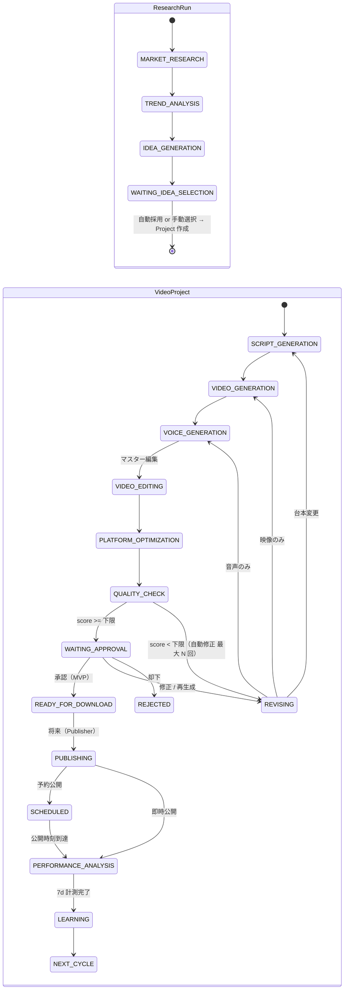

# ワークフロー設計

## 2 つの状態機械

指示書 §9 の状態列を、実体に合わせて 2 つのエンティティに分けて管理する（同じ enum を共有）。

- **ResearchRun（チャンネル単位）**: 市場分析 → トレンド分析 → 企画生成 → 企画選択
- **VideoProject（動画単位）**: 台本 → 動画 → 音声 → 編集 → QC → 承認 → 投稿 → 分析
- **Channel サイクル**: `LEARNING` → `NEXT_CYCLE`（成功パターン更新後、次の ResearchRun を起動）



Phase 1 では `SCRIPT_GENERATION → PLATFORM_OPTIMIZATION（テキストのみ）→ WAITING_APPROVAL`（台本承認モード）に短縮する。

§9 の `YOUTUBE_UPLOAD` は複数 SNS 対応に合わせて `PUBLISHING`（Target ごと）に一般化した（ADR-007）。

## 状態一覧

| 状態 | 実行内容 | Job | 人間ゲート | 主な失敗時動作 |
|------|------|------|------|------|
| IDLE | なし | — | — | — |
| MARKET_RESEARCH | YouTube データ収集 | `market_research` | — | クォータ不足 → `PAUSED(QUOTA)`、翌日自動再開 |
| TREND_ANALYSIS | Claude 分析 + Trend Score | `trend_analysis` | — | Retry → `FAILED` |
| IDEA_GENERATION | A/B/C 案 + Originality | `generate_idea` | — | Retry |
| WAITING_IDEA_SELECTION | 既定 `AUTO_TOP`: 条件を満たす案のうち Trend Score 最高案を自動採用して通過。`MANUAL`、または条件を満たす案がない場合は担当者の選択を待つ（ADR-006） | — | `MANUAL` 時 ✔ | 期限切れで通知 |
| SCRIPT_GENERATION | 台本 JSON 生成・Zod 検証 | `generate_script` | — | Schema 不一致は再要求（最大 2 回） |
| VIDEO_GENERATION | シーン毎に生成・ポーリング・DL | `generate_video` | — | Retry 3 → 別 Provider → 通知 |
| VOICE_GENERATION | ナレーション生成 | `generate_voice` | — | Retry 3 → 別 Provider |
| VIDEO_EDITING | **マスター**編集（FFmpeg 結合・BGM・9:16 クリーン版 + 字幕データ） | `render_video` | — | Retry 2 → `FAILED` |
| PLATFORM_OPTIMIZATION ★ | 選択された Target のメタデータを Claude 1 回で一括生成・検証し、Target 別に FFmpeg でレンダリング（キャッシュあり） | `optimize_platforms` | — | Target 単位で失敗を隔離（他の Target は続行） |
| QUALITY_CHECK | 実測（尺/LUFS/解像度）+ Claude 評価 | `quality_check` | — | — |
| WAITING_APPROVAL | 承認依頼通知 | — | ✔ | リマインド通知 |
| REVISING | 修正指示から差分方針を Claude が決定 | `revise` | — | — |
| READY_FOR_DOWNLOAD ★ | 承認済み Target の MP4 とテキストを署名付き URL で提供（MVP の終点） | — | — | — |
| PUBLISHING（旧 YOUTUBE_UPLOAD） | Target ごとに Publisher Adapter で投稿（YouTube は Phase 3 から） | `publish_content` | 承認済み Target のみ | Retry（YouTube は同一 upload session を再開） |
| SCHEDULED | 公開待ち | — | — | — |
| PERFORMANCE_ANALYSIS | 1h/3h/6h/12h/24h/48h/7d に統計取得 | `analyze_performance`（遅延） | — | 欠損は次回に補完 |
| LEARNING | 成功パターン抽出・更新 | `learn` | — | — |
| NEXT_CYCLE | 次 ResearchRun を（設定に応じ）起動 | — | — | — |
| PAUSED | 予算超過・クォータ不足・手動停止 | — | 再開操作 | — |
| FAILED | 自動回復不能 | — | 再実行操作 | 通知 |
| REJECTED / CANCELLED | 終了 | — | — | — |

## 遷移のガード（Workflow Engine が必ず確認）

1. **許可遷移表**: `transitions.ts` に定義された遷移のみ可能（Claude が提案しても表に無ければ拒否）。
2. **予算ガード**: 次ジョブの推定コスト + 当日/当月の実績 ≤ 上限。超過時は `PAUSED(BUDGET)`。
3. **クォータガード**: YouTube 残量 ≥ 次ジョブの必要量 + 予備（投稿用に 1,600u を常に確保）。
4. **人間ゲート**: `PUBLISHING` は Target ごとに `approval_requests.status = APPROVED` かつ承認時スナップショットと現行バージョンが一致する場合のみ。
5. **自動投稿ポリシー**（Phase 6、既定 OFF）:
   `quality >= 90 AND originality >= 85 AND policy_risk = LOW AND copyright_risk = LOW AND auto_publish = ON`
   の全てを満たし、かつ直近 N 本が人間承認済みで問題なしの場合のみ人間ゲートを省略。

## Job 共通仕様

| 項目 | 内容 |
|------|------|
| 状態 | `QUEUED` → `RUNNING` → `SUCCEEDED` / `FAILED` / `CANCELLED`、外部待ちは `WAITING_EXTERNAL` |
| 記録 | status, started_at, completed_at, retry_count, error_message, cost（`workflow_jobs`） |
| 冪等性 | `idempotency_key` unique。再実行時は既存結果を返す |
| Heartbeat | 30 秒毎更新。5 分途絶で reaper が再投入 |
| Retry | 指数バックオフ + ジッター（例: 30s, 2m, 8m）。4xx（入力不正・拒否）はリトライしない |
| キュー分離 | `llm` / `youtube` / `video` / `tts` / `render` / `analytics` に分け、並列数・レート制限を個別設定 |

## エラー処理フロー（§29）

```
Provider 呼び出し失敗
 ├─ リトライ可能（429 / 5xx / タイムアウト） → 指数バックオフで最大 3 回
 │    └─ 3 回失敗 → Provider Registry の次候補へフォールバック
 │         └─ 全候補失敗 → 該当 Project のみ FAILED、担当者へ通知
 ├─ コンテンツ拒否（Safety filter / refusal） → Claude にプロンプト修正を依頼（最大 2 回）→ 失敗で通知
 └─ 入力不正（4xx） → 即 FAILED（バグとして system_logs に記録）
```

1 つの Project / Provider の障害は他の Project を止めない（キュー・並列数を分離）。Circuit Breaker（連続失敗で一定時間その Provider を除外）を Registry に持たせる。

## 修正フロー（§23）

1. 担当者が「冒頭を強く」「20 秒に変更」等を入力
2. `revise` ジョブ: Claude に **現行台本 + 修正指示 + 変更禁止事項（企画の核・ターゲット）** を渡し、`{ scope, changed_scenes[], new_script }` を構造化出力で取得
3. 新しい `scripts.version` を作成、`project_revisions` に記録
4. 変更されたシーンだけ動画・音声を再生成（未変更は再利用）→ 再レンダリング → QC → 承認待ち

## 投稿後計測（§25）

- 公開時刻を起点に BullMQ の遅延ジョブを 7 本登録（1h, 3h, 6h, 12h, 24h, 48h, 7d）
- 各回 `videos.list`（1u）で views / likes / comments を取得、Analytics API で視聴維持率等（24〜72h 遅延のため 48h / 7d で取得）
- 7d 完了で `LEARNING` へ
